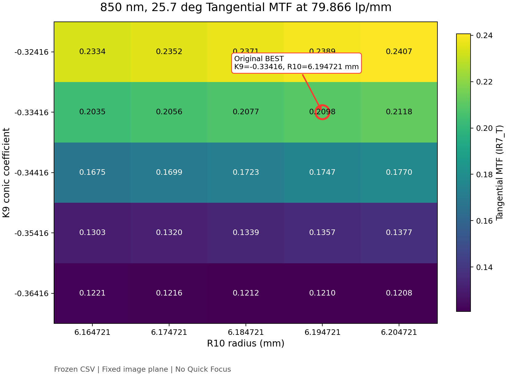
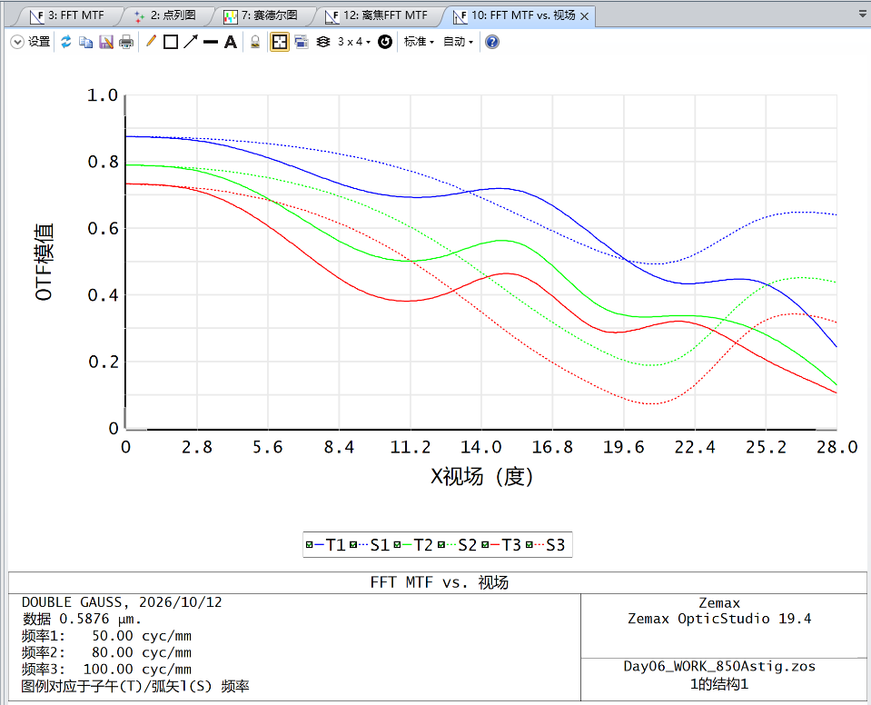
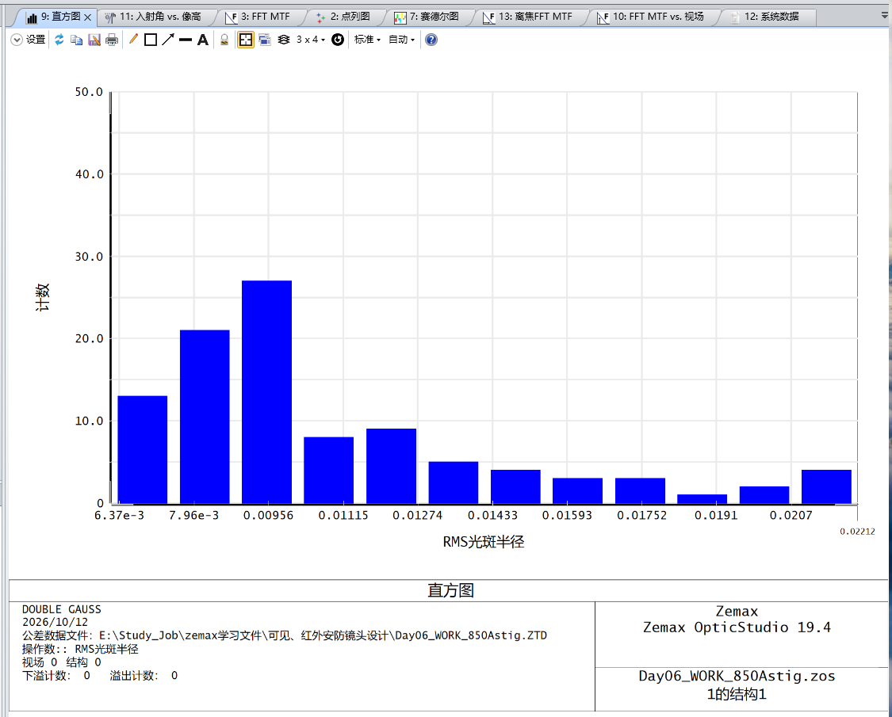

# Day06 双高斯安防镜头：固定像面 ZOS-API 参数扫描

## 案例定位

本案例面向可见光—近红外安防成像，设计目标为约 `6 mm` 焦距、`F/2.0`，覆盖 `486.1 / 587.6 / 656.3 / 850 nm`。它补充了仓库中的 Cooke Triplet 主研究链：Cooke 案例用于展示单一空气间隔、Quick Focus、Spot/MTF/Merit Function 与审计流程；本案例则展示双高斯模型在**固定像面、无 Quick Focus**条件下的双参数真实 ZOS-API 扫描。

仓库不分发原始 `.zos` 模型。正式扫描使用本地 `Day06_BEST_850Astig.zos`，运行清单记录的源模型 SHA256 为：

```text
dd35b54a4eb56745fd719cb6e38d9ac5de1dce5ed994b2a5d403c04ddf0f2a39
```

## API 扫描设计

扫描脚本为 [`scripts/demos/day06_double_gauss_api_scan.py`](../../scripts/demos/day06_double_gauss_api_scan.py)。它通过 `StandaloneZemaxConnection` 调用真实 OpticStudio ZOS-API，并在内存中组合扫描：

- 面 7 圆锥系数固定为 `K7 = 0.27900`；
- 面 9 圆锥系数 `K9` 取 5 个值：`-0.36416` 至 `-0.32416`，步长 `0.01`；
- 面 10 曲率半径 `R10` 取 5 个值：`6.164721 mm` 至 `6.204721 mm`，步长 `0.01 mm`；
- 共 `5 × 5 = 25` 组参数组合；
- FFT MTF 采用 `128 × 128` 采样，目标频率为 `80 lp/mm`；Zemax 数据序列中实际最近采样点为 `79.86622073578596 lp/mm`。

每组参数提取 6 个“视场 × 波长”状态的切向（T）和弧矢（S）MTF：

| 标签 | 视场 | 波长 |
|---|---:|---:|
| IR7 | 25.7° | 850 nm |
| IR4 | 7° | 850 nm |
| V587_7 | 25.7° | 587.6 nm |
| V587_4 | 7° | 587.6 nm |
| V486_7 | 25.7° | 486.1 nm |
| V656_7 | 25.7° | 656.3 nm |

因此冻结 CSV 包含 `25` 行案例和 `25 × 6 × 2 = 300` 个 MTF 数值。数据文件见 [`scan_fft_mtf.csv`](../../results/day06_double_gauss/scan_fft_mtf.csv)，其 SHA256 为：

```text
82327d723c4d07fffe7b06751ba141b70824419e0a60fa26bf1512cacc06d98c
```

## 固定像面与模型保护

本案例有意不把离焦补偿混入结构参数比较：

1. 扫描开始时读取像面前一面的厚度；每组计算前检查该厚度未变化；
2. 脚本不调用 Quick Focus，也不执行优化；
3. `K9` 与 `R10` 只在内存中写入，异常或正常结束时均恢复原值；
4. 脚本不调用 `Save` 或 `SaveAs`；
5. 运行前后比较源模型 SHA256，变化即报错；
6. 本地运行清单记录 `backend=real_zosapi`、`quick_focus=false`、`model_saved=false` 和 `cases_completed=25`。

三个辅助检查脚本分别验证基准结构、单次 FFT MTF 读取以及参数只写内存并恢复：

- [`day06_baseline_check.py`](../../scripts/validation/day06_baseline_check.py)
- [`day06_fft_mtf_check.py`](../../scripts/validation/day06_fft_mtf_check.py)
- [`day06_parameter_write_check.py`](../../scripts/validation/day06_parameter_write_check.py)

## 结果与关键权衡

基准结构对应 CSV 的案例 19（`K9=-0.33416`、`R10=6.194721 mm`）。在 `79.866 lp/mm` 处，它的 850 nm、25.7° 结果为 `T=0.20976`、`S=0.52522`，而 486.1 nm、25.7° 为 `T=0.06804`、`S=0.48436`。

25 点数据没有给出一个对所有状态同时最优的组合：

- 案例 25（`K9=-0.32416`、`R10=6.204721 mm`）取得最高的 850 nm 边缘视场 T 值 `0.24066`，同时也取得本扫描中最高的 486.1 nm 和 656.3 nm 边缘视场 T 值；
- 850 nm 边缘视场 S 值的最高点仍是基准案例 19，为 `0.52522`；
- 587.6 nm 边缘视场 S 值的最高点出现在案例 3（`K9=-0.36416`、`R10=6.184721 mm`），为 `0.53407`；
- 850 nm、7° 的 T/S 最高点出现在案例 21（`K9=-0.32416`、`R10=6.164721 mm`）。

这说明 `K9` 与 `R10` 会在波段、视场以及 T/S 方向之间重新分配性能。CSV 可用于筛选候选或说明趋势，但在没有探测器像元、场景权重和最低 MTF 门槛之前，不应把单一指标的最大值宣布为最终工程最优。

下图直接读取冻结 CSV，展示 850 nm、25.7°、`79.866 lp/mm` 处 `IR7_T` 的双参数响应。红色圆圈标记原 BEST 参数 `K9=-0.33416`、`R10=6.194721 mm`；绘图过程不连接 ZOS-API，也不修改原始 CSV。



作为设计状态的补充，既有 OpticStudio 视图展示了可见光波段 FFT MTF 随视场的变化：



## GUI Monte Carlo 初步公差

在 OpticStudio GUI 中另行完成了 `100` 次 Monte Carlo 初步公差分析，采用 RMS 光斑半径作为观察量。项目现有摘要记录的名义值约为 `6.95 μm`、样本均值约为 `10.85 μm`、P90 约为 `16.51 μm`；仓库当前只归档直方图，没有用逐次样本表独立复算这三个摘要值。这一步用于初步识别装调与制造扰动下的分布形态，为后续公差分配提供线索。



必须明确：该 100 次 Monte Carlo 是 **GUI 计算**，不是上述四个 Python 脚本完成的 ZOS-API 公差自动化。仓库当前也没有冻结完整的公差操作数、概率分布、补偿器规则和逐次样本表，因此它只能作为初步公差证据，不能单独构成量产公差结论或可由仓库离线复现的正式验收结果。

## 验证边界

- 25 组 CSV 是一次已完成的真实 ZOS-API 计算结果；本说明只整理并核对原始数值，没有重新运行或补造结果。
- 固定像面扫描与 Cooke 主线的逐案例 Quick Focus 是两种不同实验条件，结果不能直接混合比较。
- 可见光 MTF 与 GUI Monte Carlo 图是既有 OpticStudio 视图的原样归档；IR7_T 热图则只对冻结 CSV 做离线可视化，不重新进行光学计算。
- 扫描仅覆盖给定的局部 `K9 × R10` 网格，不证明网格外不存在更优设计。
- 当前未完成统一 `ZemaxBackend`；真实能力仍由 `modules/zemax/` 和受控 Day 脚本提供。
- Cooke Day80 冻结证据、已消费审批和历史实验配置不属于本案例的修改范围。
